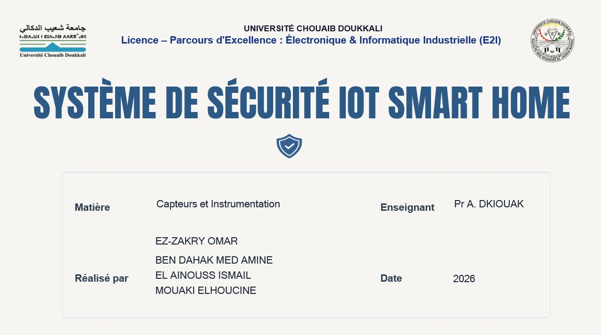
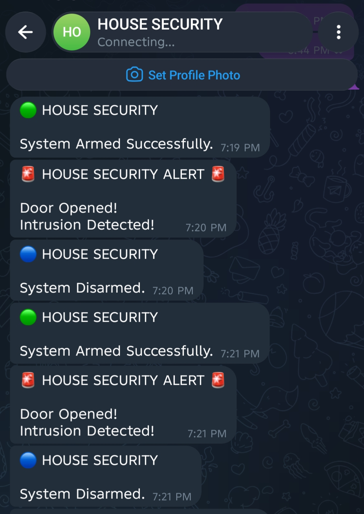
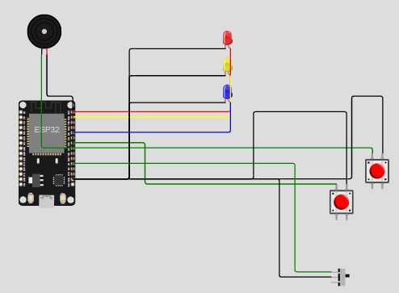

# 🏠 House Security System

An ESP32-based IoT home-security prototype that monitors a door using a magnetic reed switch, provides local alerts through a buzzer and LEDs, and sends Telegram notifications over Wi-Fi.

---

## 📖 Project Overview

The project demonstrates the integration of embedded input sensing, alarm outputs, Wi-Fi communication, and Telegram Bot messaging. As documented, opening the monitored door while the system is armed triggers a local alarm and a Telegram notification.

> **Prototype notice:** This is an educational engineering project, not a certified or independently tested security product. Notification delivery depends on power, Wi-Fi, Telegram availability, and the firmware configuration.

---

## ✨ Features

- 🔒 Arm and disarm the security system
- 📱 Telegram notifications in real time
- 🚪 Door status monitoring using a reed switch
- 🔔 Buzzer alarm
- 💡 LED status indicators
- 📶 Wi-Fi connectivity using ESP32

---

## 🧩 System Architecture

```text
Door / magnetic reed switch
             |
             v
      ESP32 controller <---- Arm / disarm inputs
             |
       +-----+-----------------+
       |                       |
       v                       v
  Buzzer + LEDs           Wi-Fi connection
                               |
                               v
                         Telegram Bot
                               |
                               v
                        User notification
```

This is a high-level functional diagram of the documented design, not a pin-level wiring diagram. See the circuit image below for the hardware illustration.

---

## 🛠 Hardware Components

- ESP32 Development Board
- Magnetic Reed Switch
- Buzzer
- LEDs
- Push Buttons
- Breadboard
- Jumper Wires

---

## 💻 Software

- Arduino IDE
- ESP32 Board Package
- UniversalTelegramBot Library
- ArduinoJson Library

---

## 📂 Project Structure

```
House-Security-System
│
├── Code
├── Images
├── Circuit
├── Documentation
├── LICENSE
└── README.md
```

---

## 📷 Project Images

Project prototype



Telegram notification



Circuit



---

## 🚀 Getting Started

**Prerequisites:** An ESP32 board, the listed hardware components, Arduino IDE with ESP32 board support, and the required `UniversalTelegramBot` and `ArduinoJson` libraries.

1. Inspect the files in `Code/`, the circuit illustration, and any notes in `Documentation/`.
2. Assemble the hardware according to the project's circuit documentation; verify the ESP32 GPIO assignments against the actual source code.
3. Install the ESP32 board package and required libraries in Arduino IDE.
4. Create a Telegram bot and obtain the bot token and intended chat ID.
5. Configure Wi-Fi and Telegram credentials **locally** as required by the sketch. Do not commit real passwords, tokens, or chat IDs to GitHub.
6. Select the correct ESP32 board and serial port, then compile and upload the firmware.
7. Test arming/disarming, door detection, buzzer/LED behavior, and notification delivery in a controlled setup.

> Exact pins, board settings, and configuration variables depend on the firmware in `Code/`. This README does not claim a universal wiring map or a verified installation procedure for every board revision.

---

## 🔐 Security & Reliability Notes

- Keep Wi-Fi passwords, Telegram bot tokens, and chat IDs out of public source files and screenshots. If a real token has already been exposed, revoke and rotate it.
- Add or check `.gitignore` rules for local credential/configuration files as needed.
- Telegram notifications require a working network connection; a local alarm should not be assumed to guarantee remote delivery.
- Verify behavior after a reboot, Wi-Fi loss, or power interruption before relying on the prototype.

---

## 🧪 Suggested Validation Checklist

The items below are **recommended tests**, not published measurements or claims of completed validation:

- [ ] Arm and disarm the system
- [ ] Open/close the door and verify sensor detection
- [ ] Check buzzer and LED responses
- [ ] Confirm Telegram notification receipt
- [ ] Check behavior during Wi-Fi disconnection/reconnection
- [ ] Check recovery after reset or power cycling
- [ ] Record test observations and limitations in `Documentation/`

---

## 🔮 Future Improvements

- Mobile Application
- Motion Sensor Integration
- Camera Support
- Cloud Database
- Voice Assistant Integration

---

## 👨‍💻 Author

**Omar Ez-Zakry**

Master's Student in Embedded Electronics and Industrial Informatics

Morocco 🇲🇦
